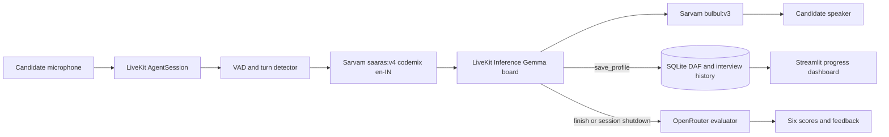

# UPSC Personality Test Voice Mock

A real-time mock UPSC Civil Services Personality Test for English and Hinglish speakers. A voice board generates questions from the candidate's DAF and answers, asks follow-ups, and returns six-dimension feedback from a separate evaluator model.

## Architecture



The board LLM generates each question; there is no fixed question bank or RAG. The board does not score itself. At the end of an interview, the transcript goes to a separate evaluator for clarity, depth, balance, awareness, authenticity, and composure. Shutdown evaluation is a backstop for calls that end before the board invokes its tool. Speech uses a cascaded STT → LLM → TTS pipeline so transcripts and evaluation inputs remain available.

## Run locally

This repository's Python project is in this directory. It uses Python 3.12 and `uv`.

```bash
uv sync --dev
cp .env.example .env.local
# Fill in LiveKit and Sarvam credentials in .env.local.
# Set ENABLE_MEMORY=1 in your shell only if you want local profile/history persistence.
ENABLE_MEMORY=1 uv run src/agent.py dev
```

Set `OPENROUTER_API_KEY` in the process environment for post-interview evaluation and the evaluator scripts. The default evaluator is `nvidia/nemotron-3.5-lightning:free`. Optional `LLM_FALLBACK_MODELS` accepts comma-separated OpenRouter model IDs; fallback models may be paid, so configure only models you intend to use. Calls are serialized and spaced by 3.1 seconds by default; change with `OPENROUTER_MIN_INTERVAL` if your provider limit differs. `OPENROUTER_RETRIES` defaults to five; server-provided `Retry-After` delays take priority.

Memory is off by default. Set `ENABLE_MEMORY=1` to retain candidate profiles, interview history, board questions, transcripts, and evaluation files; the dashboard needs this setting to show saved progress. `DEMO_MODE=true` always forces memory off, disables LiveKit session recording, and applies the 15-minute cap.

Run the dashboard:

```bash
uv run streamlit run dashboard/app.py
```

## Evaluation

```bash
uv run python evals/run_all.py
```

This runs the Sarvam clip benchmark, resumable synthetic interviews, and transcript judge, then writes CSVs and `results/SUMMARY.md`. The STT run requires a Sarvam API key. The OpenRouter simulations and LLM judge require an OpenRouter key and are subject to account and provider limits. For local-only board metrics, use `--no-llm`; skip metered stages with `--skip-stt` or `--skip-sim`.

### Recorded results

The STT benchmark currently has 12 read-aloud clips from one speaker. With `saaras:v4`, `codemix`, and `en-IN`, term recall is 0.917, WER is 0.095, and median batch transcription latency is 2.295 seconds. WER is not comparable across scripts. This is a small read-aloud benchmark, not streaming latency or general Hindi-medium performance. Observed confusions include “Directive Principles” and “Tibetan plateau.”

Four earlier live transcripts averaged 8.75 board turns and 26.5 words per board turn, with no multi-question turns or praise slips. The measured median components averaged about 0.73 seconds for end-of-turn, 0.62 seconds for LLM first token, and 0.22 seconds for TTS first byte (about 1.56 seconds total). Those four sessions all lacked a `finish_interview` tool call; shutdown evaluation has since been added, and these historical measurements do not verify that new lifecycle in a live call.

#### Example scorecard

The available live transcripts do not include saved evaluator results. I attempted to score the longest eligible live transcript, but the evaluator request could not reach OpenRouter in this environment. No real-interview scores are reported here rather than estimating them.

| Clarity | Depth | Balance | Awareness | Authenticity | Composure | Overall | Weakest |
|---|---|---|---|---|---|---|---|
| Not scored | Not scored | Not scored | Not scored | Not scored | Not scored | Not scored | Not scored |

#### Does the evaluator discriminate?

| Simulated candidate | Behaviour | Overall score |
|---|---|---:|
| Strong | Structured, examples, multi-sided, admits uncertainty | Not run |
| Vague | Generic buzzwords, no depth | 7.0/10 (previous partial run) |
| Bluffer | Confident wrong facts, bluffs when unsure | Not run |
| One-sided | Extreme opinions, ignores the other side | Not run |

The available results do not establish correct ranking: the only completed persona is vague at 7.0/10, which is too generous for the scripted behaviour. The requested fresh checks could not be completed because the environment blocks network access, and automatic review rejected sending the real interview transcript to OpenRouter without specific authorization for that export. Simulations measure prompt compliance on the selected OpenRouter simulation model, not on production Gemma. Small samples and model/provider variance limit conclusions.

## Privacy and demo mode

Unless `ENABLE_MEMORY=1` and `DEMO_MODE` is not true, the agent skips SQLite reads and writes and local transcript/evaluation files. `DEMO_MODE=true` also disables LiveKit session recording. Profile details and evaluation stay in the active session and are not stored by this application. Sessions have a 15-minute limit. LiveKit Cloud still processes the realtime media needed to carry the call; with Agent Observability enabled, LiveKit may retain transcripts, traces, logs, and recordings for up to 30 days, so this app sets `record=False` in demo mode. Review the LiveKit project settings and the current provider policies before making a public deployment.

Do not put secrets in the repository. `.env.local`, `.env.deploy`, the SQLite database, transcripts, evaluations, and recorded WAV clips are excluded by `.gitignore`.

## Known limitations and roadmap

- English-first Hinglish STT clips, one speaker; Hindi-medium accuracy is untested.
- Voice-only scoring cannot assess facial expression or other non-verbal communication.
- The board's current-affairs knowledge may be stale; it asks candidates to explain recent developments rather than inventing specifics.
- DAF PDF upload, a current-affairs source, per-user accounts, and a hosted database are roadmap items.
- The evaluator is a separate LLM and can be unavailable or inconsistent; scores should be reviewed as coaching feedback, not official UPSC assessment.

## Project layout

- `src/agent.py`: LiveKit session, board tools, lifecycle and post-call evaluation
- `src/prompts.py`: board persona, speech rules, interview variety and candidate history
- `src/db.py`: local SQLite profile and interview history
- `src/evaluator.py`, `src/llm_client.py`: separate OpenRouter evaluator and resilient HTTP client
- `src/session_log.py`: transcript/latency capture and shutdown evaluation hook
- `evals/`: STT clips, simulations, transcript judge and combined runner
- `dashboard/app.py`: Streamlit progress and quality dashboard
